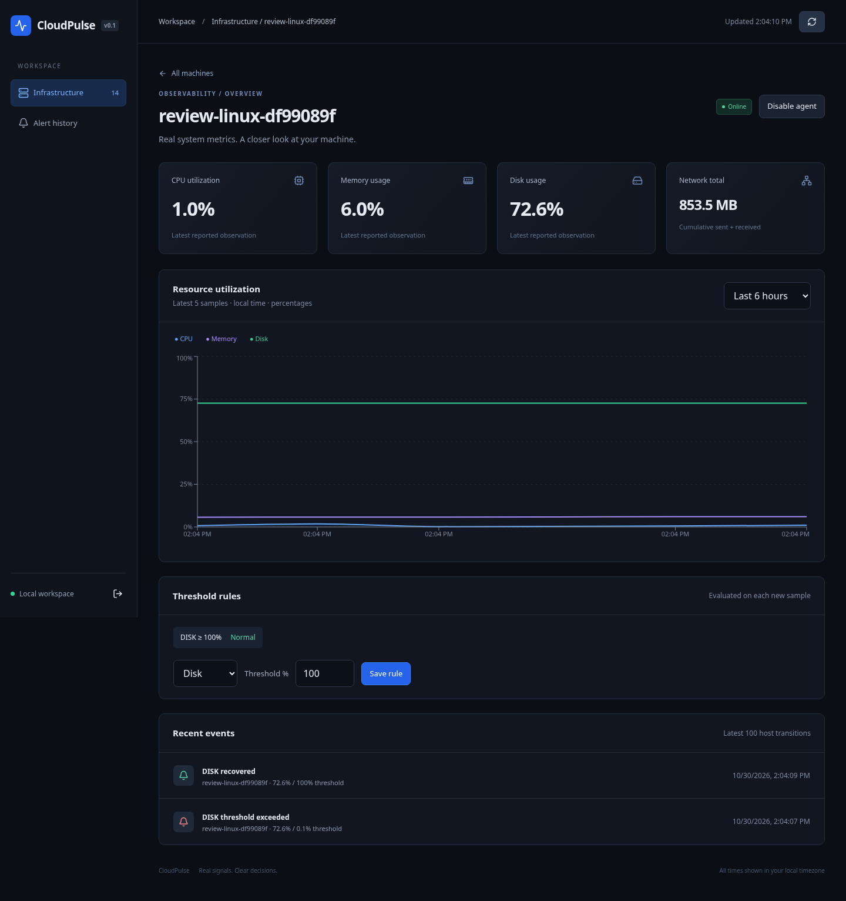
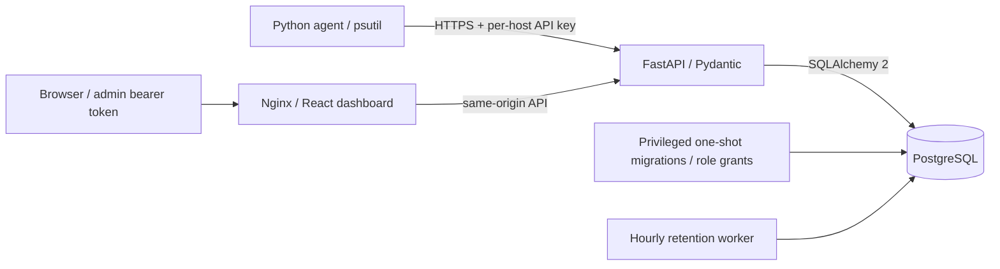

# CloudPulse

Self-hosted infrastructure monitoring with a cross-platform Python agent, a FastAPI API, PostgreSQL, and a dark React dashboard. Real CPU, memory, disk and cumulative network counters travel from psutil to persistent storage and historical charts.



**Readiness:** verified for local single-user operation; internet production deployment is not approved. See the [production review](docs/PRODUCTION_REVIEW.md) for evidence and remaining gates.

## Start locally

Requirements: Docker Engine/Desktop with Compose v2; Python 3.12+ for the agent.

```sh
python scripts/bootstrap.py
docker compose up --build -d --wait
```

Bootstrap preserves existing credentials and adds the separate runtime database password when upgrading an older `.env`. Compose runs a one-shot privileged `migrate` service before starting the API; the API and retention worker use a restricted PostgreSQL role.

Open the dashboard on local port **8080**. Read `CLOUDPULSE_ADMIN_TOKEN` from your generated `.env` locally and enter it in the sign-in form. The token stays in browser memory and is cleared on reload. The API listens on local port **8000**; interactive API docs are at `/docs`. Both published ports bind to `127.0.0.1`. PostgreSQL has no published port.

1. Click **Register machine** and choose a name.
2. Save the displayed host ID and API key. Keys are shown once and stored only as SHA-256 hashes on the server; never commit them.
3. Install and start the agent on the machine you want to observe:

```sh
python -m venv .venv
# Linux/macOS:
source .venv/bin/activate
pip install ./agent
export CLOUDPULSE_SERVER=http://127.0.0.1:8000
export CLOUDPULSE_HOST_ID='<registered-host-id>'
export CLOUDPULSE_AGENT_KEY='<registration-key>'
cloudpulse-agent
```

Use an HTTPS reverse proxy and a trusted certificate for remote agents. The agent rejects plain HTTP to non-loopback servers. Do not publish the dashboard directly to the internet: this project uses a single shared admin bearer token, not a multi-user identity system. The admin token authorizes registration, queries, rule changes, key rotation, disabling agents and retention. Agent keys authorize only ingestion for their registered host.

Registration assigns a stable UUID. Reuse that ID/key across agent restarts; a machine hostname change does not change identity. Do not register the same agent on every startup.

## Windows 11: VS Code + Docker Desktop

Run the agent in **native Windows PowerShell**, not WSL or a Docker container, to measure your Windows PC. Docker Desktop runs the API, dashboard and PostgreSQL in Linux containers. Node.js and a local PostgreSQL installation are not required for this workflow.

### 1. Install and check prerequisites

Install [Git for Windows](https://git-scm.com/download/win), [VS Code](https://code.visualstudio.com/), [64-bit Python 3.12](https://www.python.org/downloads/windows/) with the Python launcher, and [Docker Desktop](https://docs.docker.com/desktop/setup/install/windows-install/). Install the VS Code Python extension if you want editor support.

Docker Desktop requires hardware virtualization and its WSL 2 backend. In an **Administrator PowerShell** window, run `wsl --status`. If WSL is missing, run `wsl --install`, restart Windows when prompted, and complete its setup. Open Docker Desktop, enable **Use the WSL 2 based engine**, and use **Linux containers**. Wait until Docker Desktop reports its engine is running.

Open a new ordinary PowerShell terminal and check:

```powershell
git --version
py -3.12 --version
docker version
docker compose version
```

`docker version` must show both Client and Server. If `py -3.12` is missing, install Python 3.12 and reopen the terminal. If the server is unavailable, start Docker Desktop before continuing.

### 2. Clone the implementation and open VS Code

Until this PR is merged, clone the implementation branch explicitly:

```powershell
New-Item -ItemType Directory -Force "$HOME\source" | Out-Null
Set-Location "$HOME\source"
git clone --branch feat/cloudpulse-windows https://github.com/guptaoni891-ctrl/CloudPulse.git CloudPulse
Set-Location .\CloudPulse
code .
```

If the repository is private, use Git's normal secure authentication prompt. If you already have a checkout, preserve your changes, then `git fetch origin` and `git switch --track origin/feat/cloudpulse-windows` (or `git switch feat/cloudpulse-windows` if the branch already exists). Do not reset or delete your checkout. After merge, new clones can use `main`.

In VS Code choose **Terminal → New Terminal → PowerShell**, and make sure the working directory is the repository root. If `code` is not on PATH, use **File → Open Folder** in VS Code instead.

### 3. Start the local platform

Run from the repository root:

```powershell
py -3.12 scripts/bootstrap.py
docker compose up --build --detach --wait
docker compose ps
Invoke-RestMethod -Uri 'http://127.0.0.1:8000/api/v1/health'
Start-Process 'http://127.0.0.1:8080'
```

The health response must show `status: ok`. The `migrate` service exiting successfully is expected; DB, backend, frontend and retention should keep running. The first build downloads dependencies and can take several minutes.

Open `.env` **locally in VS Code**, copy only `CLOUDPULSE_ADMIN_TOKEN`, and paste it into the dashboard sign-in form. Never share or commit `.env`. Bootstrap preserves existing credentials and adds the separate runtime DB secret to older configurations. On Windows, keep the checkout in your private user directory and restrict `.env` through its **Properties → Security** permissions; Unix mode 0600 does not establish Windows ACL protection.

Click **Register machine**, enter a name such as `windows11-dev`, and keep the returned host ID and one-time agent API key. The admin token signs into the dashboard; the agent must use its own registered key.

### 4. Run the agent on your PC

Open a **second PowerShell terminal** in VS Code, also at the repository root. No virtual-environment activation or execution-policy changes are needed:

```powershell
py -3.12 -m venv .venv
.\.venv\Scripts\python.exe -m pip install .\agent
$env:CLOUDPULSE_SERVER = 'http://127.0.0.1:8000'
$env:CLOUDPULSE_HOST_ID = Read-Host 'Paste the registered host ID'
$agentKey = Read-Host 'Paste the one-time agent API key' -AsSecureString
$env:CLOUDPULSE_AGENT_KEY = [System.Net.NetworkCredential]::new('', $agentKey).Password
Remove-Variable agentKey
$env:CLOUDPULSE_INTERVAL = '10'
$env:CLOUDPULSE_DISK_PATH = "$env:SystemDrive\"
.\.venv\Scripts\cloudpulse-agent.exe --once
if ($LASTEXITCODE -ne 0) { throw 'Agent check failed; inspect the error before continuing' }
.\.venv\Scripts\cloudpulse-agent.exe
```

The masked prompt keeps the key out of your command history, while the agent still receives it as a process environment variable. Do not use `setx` or save the key in a tracked script. The foreground agent runs until **Ctrl+C**. These environment variables last only for this terminal; a new terminal needs the same host ID/key again. Reuse the registration across restarts. If the key is lost, rotate it through the admin API or register a new host.

Return to the dashboard, open your machine, and wait about 20–30 seconds for polling and several real samples. Confirm **Online**, CPU/memory/disk readings, network totals and chart lines. To monitor another drive, set `CLOUDPULSE_DISK_PATH` to an existing path such as `'D:\'` before starting the agent. Network counters are cumulative bytes, not bandwidth.

### 5. Stop, restart, and troubleshoot

Stop the agent with Ctrl+C, then clear the secret from that terminal:

```powershell
Remove-Item Env:CLOUDPULSE_AGENT_KEY -ErrorAction SilentlyContinue
docker compose logs --tail 100 migrate backend retention
docker compose down
# Start the platform again later without deleting stored data:
docker compose up --detach --wait
```

`docker compose down` preserves PostgreSQL data. **Do not use `docker compose down -v` unless you intend to delete all stored data.** To restart monitoring, repeat the agent environment-variable commands with the original registration and run the agent again.

- **Port 8000/8080 already in use:** stop the conflicting local service; inspect with `Get-NetTCPConnection -State Listen -LocalPort 8000,8080 -ErrorAction SilentlyContinue`. Keep Compose's `127.0.0.1` bindings.
- **401 from the agent:** check the host ID/key pair and whether the host is disabled. Do not substitute the dashboard admin token for the agent key.
- **No charts/offline:** keep the agent running, check its terminal, confirm the selected disk exists, and check Windows date/time synchronization. A one-shot run will become offline after the heartbeat timeout.
- **Docker pipe/engine errors:** start Docker Desktop, confirm Linux containers/WSL 2, and rerun `docker version`.
- **Backend startup failure:** inspect `docker compose logs migrate backend db`. Do not delete the database volume as a routine troubleshooting step.

All published services remain on **localhost**. No router forwarding, public bind addresses or firewall exceptions are needed. Internet deployment remains blocked by the [production security requirements](docs/PRODUCTION_REVIEW.md).

### Windows verification status

The workflow includes a `windows-latest` Python 3.12 job for native API/agent tests; the Linux job validates frontend builds and the PostgreSQL/Compose deployment. A Linux test run does not prove Windows execution. Confirm the Windows job's result in GitHub Actions and perform the PC steps above before calling Windows support verified. Native Docker Desktop/VS Code setup is a manual check, not covered by hosted-runner tests.

## What it does

- Versioned `/api/v1` REST API and database health check.
- CPU, memory and disk percentages; network bytes are cumulative host counters, **not bandwidth**. `CLOUDPULSE_DISK_PATH` selects one volume, defaulting to the home drive/root.
- Per-host keys, strict Pydantic validation, timezone-aware UTC timestamps and host/time indexes.
- Idempotent retry with sample UUIDs, bounded exponential backoff/jitter and explicit drop logging after five attempts. No offline disk spool is implemented.
- Last-seen status, offline after 60 seconds, enable/disable and key rotation API.
- Historical time ranges, up to 5,000 latest raw samples per query, returned chronologically. Charts do not fabricate or interpolate missing samples in storage.
- CPU/memory/disk threshold rules, firing/recovery transitions, and alert history. No email, paging or external notifications.
- Hourly configurable retention for metrics and historical alert events.
- Responsive dashboard with host detail routes (URL hash), polling, charts, rule editing, error/loading and empty states.

Offline indicates ingestion silence; it does not prove a machine is down. Cards show the latest sample even if a host is offline. Thresholds use `value >= threshold`; changes apply on the next newer sample. Duplicate and out-of-order samples never repeat or reverse alert transitions. Retention does not remove host registrations or rule state.

## Development and validation

```sh
python -m venv .venv
source .venv/bin/activate
pip install -r requirements-dev.lock
pytest -q tests
ruff check backend agent tests scripts
cd frontend
npm ci
npm run dev
# In another shell: npm run build (includes strict TypeScript checking)
```

For backend development, keep the Compose database/backend running, or provide `CLOUDPULSE_DATABASE_URL` to a separate local PostgreSQL instance and `CLOUDPULSE_ADMIN_TOKEN` (at least 32 random characters). Then:

```sh
alembic -c backend/alembic.ini upgrade head
uvicorn app.main:app --reload --host 127.0.0.1 --port 8000
```

Stop the Compose backend before running another process on port 8000. Vite proxies `/api` to that port, so no permissive CORS configuration is needed.

```sh
# Running deployment; adds a real smoke host, ingests a reading, then disables it:
python scripts/compose_smoke.py
# Logs, status, stop (preserves data):
docker compose logs --tail=100 backend retention
docker compose ps
docker compose down
```

`docker compose down -v` permanently deletes local monitoring data. Back up the PostgreSQL volume before using it. Changes to the DB password in `.env` do not change an initialized database's password; use PostgreSQL role management instead.

CI is configured to run SQLite and PostgreSQL pytest suites, Ruff, migration checks, TypeScript/Vite builds, real-agent ingestion, restricted-role checks, backend replacement recovery, and Compose tests. Remote GitHub Actions execution has not been verified.

```sh
# Full API/agent suite on PostgreSQL with the runtime role, in isolated test schemas:
docker compose --profile test run --build --rm test
# Admin-only migration/schema check:
docker compose run --rm migrate alembic check
# Verify the API role cannot run DDL or access migration bookkeeping:
docker compose exec -T backend python < scripts/privilege_smoke.py
# Replaces the backend; verifies proxy recovery and an existing stored sample:
python scripts/restart_smoke.py
```

SQLite skips the three PostgreSQL-only concurrency/migration checks. PostgreSQL runs them. Tests generate and drop uniquely named test schemas; do not point test credentials at an unrelated production database. See [verification](docs/VERIFICATION.md) for observed results.

### Optional browser smoke

Install `requirements-browser.txt` separately and provide a local Chromium executable via `CHROMIUM_PATH` (defaults to `/usr/bin/chromium`):

```sh
pip install -r requirements-browser.txt
python scripts/browser_smoke.py
```

Run this against Compose with Docker access. It executes the actual agent CLI, independently reads PostgreSQL rows, compares REST results and rendered metric cards, checks all three chart series, rule editing, mobile layout, sign-out and auth failures. Screenshots go to ignored `.local/review-screenshots` by default (`CLOUDPULSE_SCREENSHOT_DIR` overrides this). It creates a uniquely named machine and disables it afterward. `python scripts/browser_regressions.py` also verifies that a registration response delayed across sign-out cannot expose its key in a new session.

## Configuration

| Variable | Purpose | Default |
|---|---|---|
| `POSTGRES_PASSWORD` | Database owner credential, used by DB/migrator/test setup only | generated by bootstrap |
| `CLOUDPULSE_DB_PASSWORD` | Restricted runtime DB role password; at least 32 URL-safe characters | generated by bootstrap |
| `CLOUDPULSE_ADMIN_TOKEN` | Server admin bearer token | required, minimum 32 chars |
| `CLOUDPULSE_DATABASE_URL` | SQLAlchemy connection URL | local PostgreSQL |
| `CLOUDPULSE_RETENTION_DAYS` | Accepted sample age / retained data | 30 |
| `CLOUDPULSE_OFFLINE_SECONDS` | Online status timeout | 60 |
| `CLOUDPULSE_SERVER` | Agent API base URL | loopback port 8000 |
| `CLOUDPULSE_HOST_ID` | Stable registered agent UUID | required |
| `CLOUDPULSE_AGENT_KEY` | Per-host ingestion secret | required |
| `CLOUDPULSE_INTERVAL` | Agent collection interval, seconds | 10 (range 2–3600) |
| `CLOUDPULSE_DISK_PATH` | Monitored disk path | home drive/root |

Keep interval below offline timeout, allowing margin for network delays. Timestamps more than five minutes in the future or older than retention are rejected. Sync host clocks. Health checks are intentionally public but expose only version and database availability. Database failures return a generic 500 without database credentials.

## Architecture



See [API and design](docs/ARCHITECTURE.md) and [security policy](SECURITY.md). MIT licensed.

## Troubleshooting

- **401**: use the admin token for dashboard/query/registration; use the per-host key for ingestion. Disabled agents are rejected. Re-register if a key is lost, or call the admin key-rotation endpoint and update the agent.
- **No samples**: check agent output, UUID/key pairing, disk path, clock and server address. Inside another container, localhost points to that container; run the agent on the host to observe host metrics.
- **Offline**: check last-seen time, collection interval, HTTP failures and the configured timeout.
- **Database startup**: `docker compose logs db migrate backend`; the privileged `migrate` service must exit successfully before the API starts. Avoid concurrent migration runners.
- **Remote HTTPS**: terminate TLS at a trusted reverse proxy and restrict access. Never disable certificate verification.
- **Proxy-managed build environments**: Docker builds accept the optional BuildKit secret `proxy_ca`. See `docs/CLOUD_ENVIRONMENT.md`; ordinary local Docker needs no override.

Runtime DB password rotation: securely replace `CLOUDPULSE_DB_PASSWORD` with a new URL-safe random value, then run `docker compose up -d --force-recreate migrate backend retention`. Existing owner-password rotation still requires PostgreSQL role management. Never run schema migrations with the runtime account.
