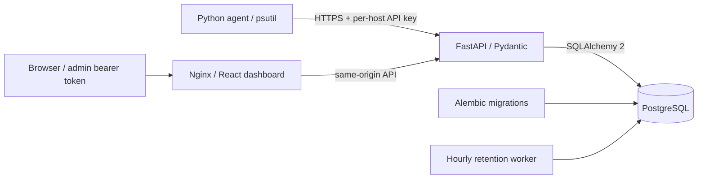

# CloudPulse

Self-hosted infrastructure monitoring with a cross-platform Python agent, a FastAPI API, PostgreSQL, and a dark React dashboard. Real CPU, memory, disk and cumulative network counters travel from psutil to persistent storage and historical charts.


## Start locally

Requirements: Docker Engine/Desktop with Compose v2; Python 3.12+ for the agent.

```sh
python scripts/bootstrap.py
docker compose up --build -d --wait
```

Open the dashboard on local port **8080**. Read `CLOUDPULSE_ADMIN_TOKEN` from your generated `.env` locally and enter it in the sign-in form. The token stays in browser memory and is cleared on reload. The API listens on local port **8000**; interactive API docs are at `/docs`. Both published ports bind to `127.0.0.1`. PostgreSQL has no published port.

1. Click **Register machine** and choose a name.
2. Save the displayed host ID and API key. Keys are shown once and stored only as SHA-256 hashes on the server; never commit them.
3. Install and start the agent on the machine you want to observe:

```sh
python -m venv .venv
# Linux/macOS:
source .venv/bin/activate
pip install ./agent
export CLOUDPULSE_SERVER=http://127.0.0.1:8000
export CLOUDPULSE_HOST_ID='<registered-host-id>'
export CLOUDPULSE_AGENT_KEY='<registration-key>'
cloudpulse-agent
```

Use an HTTPS reverse proxy and a trusted certificate for remote agents. The agent rejects plain HTTP to non-loopback servers. Do not publish the dashboard directly to the internet: this project uses a single shared admin bearer token, not a multi-user identity system. The admin token authorizes registration, queries, rule changes, key rotation, disabling agents and retention. Agent keys authorize only ingestion for their registered host.

Registration assigns a stable UUID. Reuse that ID/key across agent restarts; a machine hostname change does not change identity. Do not register the same agent on every startup.

### Windows (PowerShell)

From a local checkout with Python 3.12+ and Docker Desktop running:

```powershell
py -3.12 -m venv .venv
.\.venv\Scripts\python.exe -m pip install .\agent
$env:CLOUDPULSE_SERVER = 'http://127.0.0.1:8000'
$env:CLOUDPULSE_HOST_ID = '<registered-host-id>'
$env:CLOUDPULSE_AGENT_KEY = '<registration-key>'
$env:CLOUDPULSE_DISK_PATH = 'C:\'
.\.venv\Scripts\cloudpulse-agent.exe
```

No shell activation or execution-policy changes are necessary. Use Windows Task Scheduler to launch the executable at login if desired, supplying these variables in a protected local wrapper. Do not place credentials in task arguments or a public script. Windows compatibility is designed into the agent; validation in this repository's Linux environment does not establish a Windows runtime test.

## What it does

- Versioned `/api/v1` REST API and database health check.
- CPU, memory and disk percentages; network bytes are cumulative host counters, **not bandwidth**. `CLOUDPULSE_DISK_PATH` selects one volume, defaulting to the home drive/root.
- Per-host keys, strict Pydantic validation, timezone-aware UTC timestamps and host/time indexes.
- Idempotent retry with sample UUIDs, bounded exponential backoff/jitter and explicit drop logging after five attempts. No offline disk spool is implemented.
- Last-seen status, offline after 60 seconds, enable/disable and key rotation API.
- Historical time ranges, up to 5,000 latest raw samples per query, returned chronologically. Charts do not fabricate or interpolate missing samples in storage.
- CPU/memory/disk threshold rules, firing/recovery transitions, and alert history. No email, paging or external notifications.
- Hourly configurable retention for metrics and historical alert events.
- Responsive dashboard with host detail routes (URL hash), polling, charts, rule editing, error/loading and empty states.

Offline indicates ingestion silence; it does not prove a machine is down. Cards show the latest sample even if a host is offline. Thresholds use `value >= threshold`; changes apply on the next newer sample. Duplicate and out-of-order samples never repeat or reverse alert transitions. Retention does not remove host registrations or rule state.

## Development and validation

```sh
python -m venv .venv
source .venv/bin/activate
pip install -r requirements-dev.lock
pytest -q tests
ruff check backend agent tests scripts
cd frontend
npm ci
npm run dev
# In another shell: npm run build (includes strict TypeScript checking)
```

For backend development, keep the Compose database/backend running, or provide `CLOUDPULSE_DATABASE_URL` to a separate local PostgreSQL instance and `CLOUDPULSE_ADMIN_TOKEN` (at least 32 random characters). Then:

```sh
alembic -c backend/alembic.ini upgrade head
uvicorn app.main:app --reload --host 127.0.0.1 --port 8000
```

Stop the Compose backend before running another process on port 8000. Vite proxies `/api` to that port, so no permissive CORS configuration is needed.

```sh
# Running deployment; adds a real smoke host, ingests a reading, then disables it:
python scripts/compose_smoke.py
# Logs, status, stop (preserves data):
docker compose logs --tail=100 backend retention
docker compose ps
docker compose down
```

`docker compose down -v` permanently deletes local monitoring data. Back up the PostgreSQL volume before using it. Changes to the DB password in `.env` do not change an initialized database's password; use PostgreSQL role management instead.

CI runs pytest, Ruff, PostgreSQL migrations and a real-reading API smoke, TypeScript/Vite build and the full Compose smoke. Tests use isolated SQLite by default; PostgreSQL deployment behavior is tested by the smoke workflow. See [verification](docs/VERIFICATION.md) for checks actually run during implementation.

### Optional browser smoke

Install `requirements-browser.txt` separately and provide a local Chromium executable via `CHROMIUM_PATH` (defaults to `/usr/bin/chromium`):

```sh
pip install -r requirements-browser.txt
python scripts/browser_smoke.py
```

This verifies real registration/ingestion, rendered charts, rule editing, a 390px mobile layout and sign-out, and saves screenshots under `docs/screenshots`. It creates a real-reading machine registration and disables it at the end.

## Configuration

| Variable | Purpose | Default |
|---|---|---|
| `POSTGRES_PASSWORD` | Compose database credential | generated by bootstrap |
| `CLOUDPULSE_ADMIN_TOKEN` | Server admin bearer token | required, minimum 32 chars |
| `CLOUDPULSE_DATABASE_URL` | SQLAlchemy connection URL | local PostgreSQL |
| `CLOUDPULSE_RETENTION_DAYS` | Accepted sample age / retained data | 30 |
| `CLOUDPULSE_OFFLINE_SECONDS` | Online status timeout | 60 |
| `CLOUDPULSE_SERVER` | Agent API base URL | loopback port 8000 |
| `CLOUDPULSE_HOST_ID` | Stable registered agent UUID | required |
| `CLOUDPULSE_AGENT_KEY` | Per-host ingestion secret | required |
| `CLOUDPULSE_INTERVAL` | Agent collection interval, seconds | 10 (range 2–3600) |
| `CLOUDPULSE_DISK_PATH` | Monitored disk path | home drive/root |

Keep interval below offline timeout, allowing margin for network delays. Timestamps more than five minutes in the future or older than retention are rejected. Sync host clocks. Health checks are intentionally public but expose only version and database availability. Database failures return a generic 500 without database credentials.

## Architecture



See [API and design](docs/ARCHITECTURE.md) and [security policy](SECURITY.md). MIT licensed.

## Troubleshooting

- **401**: use the admin token for dashboard/query/registration; use the per-host key for ingestion. Disabled agents are rejected. Re-register if a key is lost, or call the admin key-rotation endpoint and update the agent.
- **No samples**: check agent output, UUID/key pairing, disk path, clock and server address. Inside another container, localhost points to that container; run the agent on the host to observe host metrics.
- **Offline**: check last-seen time, collection interval, HTTP failures and the configured timeout.
- **Database startup**: `docker compose logs db backend`; migrations run before the API starts. Avoid concurrent migration runners.
- **Remote HTTPS**: terminate TLS at a trusted reverse proxy and restrict access. Never disable certificate verification.
- **Proxy-managed build environments**: Docker builds accept the optional BuildKit secret `proxy_ca`. See `docs/CLOUD_ENVIRONMENT.md`; ordinary local Docker needs no override.
